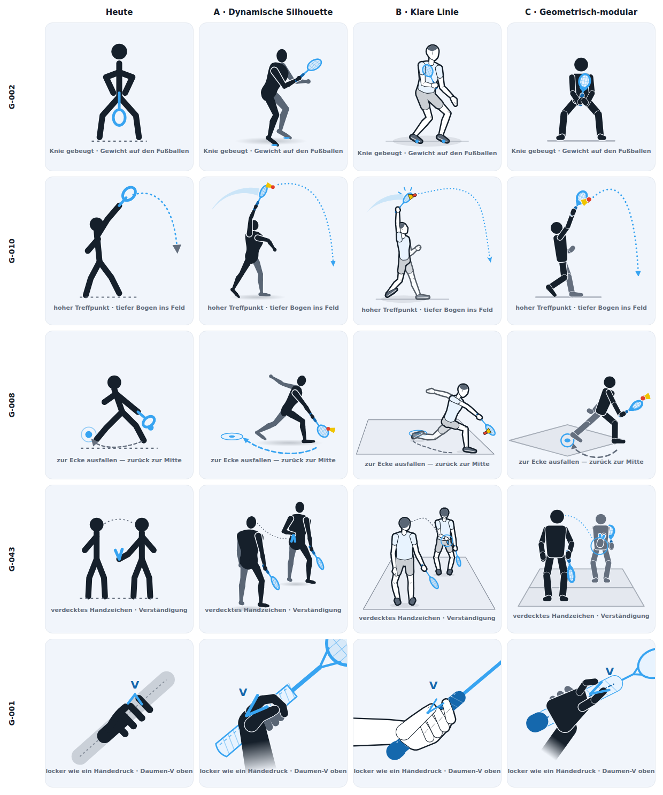
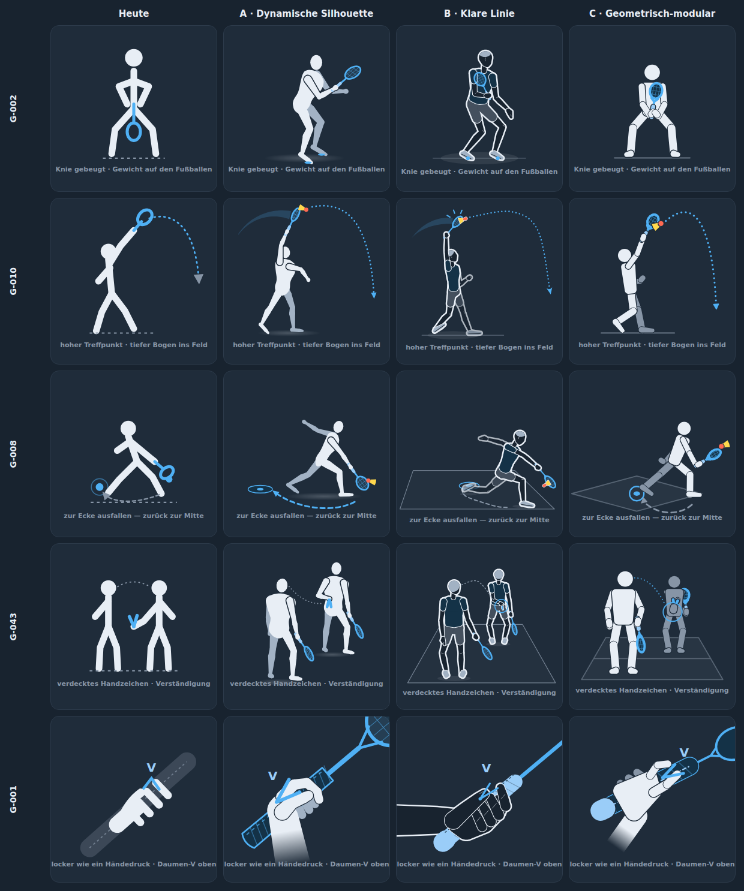

# Personengrafiken neu zeichnen: Strategie

**Stand:** Oktober 2026 · **Status:** Strategie steht, die Kernentscheidungen sind getroffen (Abschnitt 11), die Sofortmaßnahmen sind umgesetzt. Als Nächstes folgen Fundament und Pilot.

Die Grafiken mit Personen wirken banal und teilweise seltsam. Dieses Dokument legt fest, wie alle 32 dieser Grafiken neu entstehen. Der Schwerpunkt liegt auf der Ästhetik. Didaktik, Sachrichtigkeit und die technischen Regeln der App dürfen dabei nicht leiden. Es stützt sich auf drei Grundlagen:

- **Dossiers** zu allen 32 Grafiken: Motiv, didaktischer Kern aus dem Bausteintext, präzise Soll-Pose, Mängel nach Art und Schwere. Sie liegen maschinenlesbar in `scratchpad/figuren/dossiers.json`.
- **Prototypen** in drei Stilrichtungen an fünf Referenzmotiven: G-001, G-002, G-008, G-010 und G-043. Die Ganzfiguren entstehen jeweils aus einem kleinen parametrischen Generator, die Hand-Nahaufnahme G-001 von Hand aus denselben Grundformen. Alles liegt in `scratchpad/figuren/prototypen/`.
- **Zwei unabhängige Gutachten** zu den Prototypen. Das eine bewertet Gestaltung und Didaktik, das andere Umsetzung und Qualitätssicherung.

Ein Gegenlesen in drei Durchgängen hat das Dokument danach geprüft: Fakten gegen Dossiers und Repo, technische Umsetzbarkeit, Vollständigkeit.

**Maßeinheit:** Alle Maße in diesem Dokument sind Einheiten der viewBox 300 × 300. Bei 300 px Anzeigebreite entspricht eine Einheit einem Pixel.

## 1. Ziel

Jede Personengrafik soll eine Figur zeigen, die nach Sport aussieht: mit Gewicht, Spannung, glaubwürdigen Gelenken, echten Händen und Füßen und einem Crossminton-Schläger. Die Grafik trägt genau die eine Aussage ihres Bausteins und bleibt auf einem kleinen Telefon lesbar. Sie kippt wie bisher über die Tokens zwischen Hell und Dunkel und ist in allen vier Sprachen vorhanden. Alle 32 Grafiken folgen einem gemeinsamen Kanon, damit sie zusammen wie ein Satz wirken und nicht wie 32 Einzelstücke.

## 2. Umfang

Betroffen sind **32 Grafiken**. Jede liegt in vier Sprachen als SVG und PNG vor, zusammen also 128 SVG- und 128 PNG-Dateien.

| Art | Nummern |
| --- | --- |
| Ganzfiguren | G-002 bis G-008, G-010 bis G-012, G-015 bis G-020, G-022, G-032 bis G-034, G-036, G-054, G-056 bis G-058 |
| Zwei Personen | G-043, G-047, G-053, G-062 |
| Körperteil in Nahaufnahme | G-001 (Hand am Griff), G-009 (Unterarm und Handgelenk), G-035 (Fuß und Unterschenkel) |

**Nicht betroffen** sind die 35 Grafiken ohne Personen: Felddiagramme, Taktikschemata, Regelgrafiken, Material- und Bodendetails wie G-013, G-030 und G-059 sowie die Speeder-Konstruktionszeichnung G-064 bis G-067. Sie bleiben, wie sie sind, und die neuen Figuren müssen neben ihnen stimmig wirken. Zwei davon berühren das Vorhaben trotzdem:

- **G-013** (Schnitt und Spin) zeigt denselben lupenartigen Schläger und denselben Punkt-Speeder, die hier als Sachfehler behoben werden. Neben den neuen Bildern fiele das auf. G-013 sollte deshalb die neuen Schläger- und Speeder-Bauteile übernehmen, auch ohne Figur.
- **Doppel-Punktdiagramme:** G-044 beschreibt die Partner im `aria-label` wörtlich als „nebeneinander“. G-042, G-045, G-048, G-049 und G-051 zeigen sie nach Augenschein ebenfalls auf gleicher Tiefe. Sie werden vor der Doppel-Welle gegen die Regeln 7.4 und 7.5.1 geprüft, damit alte Diagramme und neue Figuren sich nicht widersprechen.

**Bleibt unverändert:** Nummern und Dateinamen (`G-XXX.svg`, `.png`, `.<sprache>.svg` und `.<sprache>.png`), die Zuordnung zu den Bausteinen, `SVG_GRAFIKEN` und `GRAFIK_SPRACHEN` in `js/oberflaeche.js` sowie die Einbindung über `grafikFigurHtml` und `verbessereGrafiken`.

## 3. Befund: warum die Bilder banal und seltsam wirken

Die Dossiers nennen über alle 32 Grafiken dieselben Ursachen. Darum hilft es nicht, einzelne Bilder auszubessern. Gebraucht wird ein neuer gemeinsamer Bauplan.

### Ästhetik und Anatomie

- **Ein Baukasten für alles.** Der Rumpf ist ein senkrechter Strich. Arme und Beine entspringen je einem Punkt, es gibt weder Schulter- noch Hüftbreite. Ellbogen und Knie fehlen weitgehend, die Beine stehen als fast gestreckter Zirkel mit Kniewinkeln von 165 bis 175°. Der freie Arm ist fast überall ein Stummel ohne Ellbogen.
- **Proportionen eines Kindermännchens.** Der Kopf nimmt etwa 18 % der Körperhöhe ein, real sind es rund 13 %. Die Beine sind zu kurz. Bei 14 Einheiten Strichstärke wirkt die Figur wie ein WC-Schild, der Schläger mit 5,5 Einheiten wie Draht. Figurhöhen schwanken zwischen 140 und 190 Einheiten, Kopfradien zwischen 12 und 16.
- **Keine Hände, keine Füße.** Gerade die Kernaussagen zu Fußballen, Fersen, Griff und Handrücken lassen sich so nicht zeigen. Die Hand in G-001 liest sich als Rechen.
- **Keine Tiefe.** Nahe und ferne Gliedmaßen sind gleich schwarz. Welches Bein vorn steht und welcher Arm frei ist, bleibt mehrdeutig.
- **Schläger im Schritt.** In G-002, G-007, G-032 und G-057 hängt der Schläger senkrecht zwischen den Beinen, in G-005 liegt der Kopf vor den Oberschenkeln. Das ist die stärkste Ursache für die seltsame Anmutung, denn die Lesart ist unfreiwillig anzüglich.
- **Schablonen-Recycling.** Die Paare G-002/G-007, G-003/G-004, G-010/G-011 und G-005/G-006 sind koordinatengleich oder fast gleich. Sechs Schlagbilder teilen dasselbe Skelett, nur der Schlagarm wechselt. Deshalb sehen alle Schläge gleich aus.
- **Kein Gewicht.** Der Rumpf ist bei Vorwärtsschlägen 5 bis 13° nach hinten geneigt. Füße schweben über der Bodenlinie oder versinken in ihr. Hilfszeichen liegen auf der Figur, etwa Wischlinien auf dem Arm oder ein Lot durch den Kopf.

### Sachliche Fehler, die beim Neuzeichnen mitbehoben werden

- **Schläger und Speeder sind nicht als solche erkennbar.** Der Schläger ist ein offener Ring an einem kurzen Stiel ohne Griff und liest sich als Lupe oder Kelle. Die Schlagfläche zeigt in Seitenansichten zur Betrachterin statt zum Ziel. Der Speeder ist ein blauer Punkt oder fehlt ganz, Kappe und Korb sind nicht zu sehen. Damit lässt sich etwa die Aussage „der ganze Speeder unterhalb der Hand“ in G-006 nicht prüfen.
- **Flugbahnen im Badminton-Maßstab.** Clear (G-010) und Smash (G-011) landen etwa eine Körperlänge vor der Figur. Sprung-Smash (G-020), Stopp (G-012) und der Stopp-Zweig in G-017 enden im Figurenmaßstab nur etwa 1 bis 1,5 m vor dem Spieler. Im Crossminton läge der Speeder damit in der neutralen Zone, denn zwischen den Feldern liegen 12,8 m (Regel 1.3). Die senkrechte Linie in G-012 liest sich als Netz.
- **Doppel Seite an Seite.** G-043 und G-053 zeigen die Partner nebeneinander, G-047 wirkt ebenso. Das widerspricht der festen Ordnung vorn/hinten nach Regel 7.4 und 7.5.1, wie sie der Doppel-Fallstrick in `CLAUDE.md` beschreibt.
- **Treffpunkte.** Der Bausteintext von `vorhand_drive` verlangt Hüfthöhe. Der Drive trifft in G-003, G-012, G-018, G-019 und G-022 aber auf Schulter- oder Kopfhöhe. G-004 zeigt mit tiefem Ellbogen ausgerechnet das Fehlerbild der Rückhand. G-015 dreht die Zeitrichtung um, weil der „spätere“ Treffpunkt weiter vorn liegt.
- **Gesundheitsrahmen.** Die Caption von G-058 empfiehlt in allen vier Sprachen zu trinken. Der Baustein schließt Trink-, Ernährungs- und Belastungsvorgaben ausdrücklich aus. Dieser Verstoß ist heute live. Die Bewegung in G-033 ist so nicht ausführbar. G-057 behauptet einen breiten Stand, der Text verlangt kurze Schritte.
- **Farbrolle.** Die Sonne in G-054, G-056 und G-058 ist in `--primaer` gezeichnet. Eine blaue Sonne liest sich als Mond oder UI-Symbol und zieht den Akzent vom Kern ab.

### Texte und Technik

- **Köpfe fehlen im Druck.** 29 der 32 Grafiken nennen den Kopfkreis `class="kopf"`. Dieselbe Klasse trägt die Kopfzeile der App, und `@media print` in `css/app.css` blendet `.kopf` aus. Wer eine Baustein-Seite druckt, bekommt darum Figuren ohne Kopf. Das ist im Browser nachgemessen: `display: none` am Kopfkreis im Druck. Gleichnamig mit App-Klassen sind außerdem `.ring` in 9 Grafiken sowie `.karte` und `.marke` in je einer. Ihre Wirkung ist im Einzelnen nicht geprüft. `vereinzele()` schützt nur das Dokument vor dem Stil einer Grafik, nicht die Grafik vor dem Stil der App.
- **Captions.** Elf Captions sollten inhaltlich geändert werden: G-005, G-009, G-010, G-011, G-033, G-035, G-043, G-054, G-056, G-057, G-058. Dazu kommt G-001 wegen Länge und Wortwahl, denn der Text sagt „Handschlag“, die Caption „Händedruck“. Die Vorschläge stehen in den Dossiers. G-001, G-009 und G-035 sind im PNG an beiden Rändern abgeschnitten. Die Faustregel „bis etwa 46 Zeichen“ ist für fette 12er-Schrift zu großzügig. Besser ist es, die Breite zu messen, statt Zeichen zu zählen.
- **Beschreibungen widersprechen dem Bild.** `aria-label` und Katalogeinträge in `images/grafik-prompts.md` nennen Dinge, die das Bild nicht zeigt, etwa „von hinten“, „gespiegelte Pfeile“ oder „tiefe Sonne“.
- **PNG-Fallbacks.** 37 der 67 PNGs liegen in 2560 × 2560 statt 600 × 600 vor, darunter alle 32 Personengrafiken. Sie stammen aus der Zeit vor der viewBox-Korrektur in `scratchpad/render-svg.mjs`. 61 der 67 SVGs nennen als Fallback für `--tinte-3` noch `#6b7686`, das Token steht inzwischen auf `#656f7e`.

## 4. Bestand im Einzelnen

Priorität A heißt: Leitgrafik eines zentralen Beginner-Bausteins oder auffällig misslungen. Das trifft auf 20 Grafiken zu, die übrigen 12 sind B. Der Aufwand ist der geschätzte Zeichenaufwand: 2 Grafiken mit S, 19 mit M, 11 mit L. Die Spalte „Welle“ ordnet nach der Serienplanung in Abschnitt 8. Sie gruppiert teils nach Thema, die genaue Grundpose jeder Grafik steht im Feld `pose_familie` der Dossiers.

| Nr. | Baustein | Welle | Prio | Aufwand | Wichtigster Befund |
| --- | --- | --- | --- | --- | --- |
| G-001 | griff | Nahaufnahme | A | L | Hand liest sich als Rechen, das V schwebt als umgekehrter Winkel neben dem Zeigefinger |
| G-002 | grundposition | Bereitschaft und Beinarbeit | A | M | Schläger hängt kopfüber im Schritt, keine Füße, keine Vorneigung |
| G-003 | vorhand_drive | Grundschlag | A | L | Treffpunkt auf Schulterhöhe statt Hüfthöhe, Schlagfläche zeigt zur Betrachterin |
| G-004 | rueckhand | Grundschlag | A | L | Kaum von G-003 zu unterscheiden, tiefer Ellbogen zeigt das Fehlerbild |
| G-005 | aufschlag | Aufschlag | A | M | Schlägerkopf vor den Oberschenkeln, Speeder ist ein Punkt, Caption mehrdeutig |
| G-006 | aufschlag | Aufschlag | A | M | Speeder überlappt den Rahmen, Kernaussage „ganz unterhalb der Hand“ nicht prüfbar |
| G-007 | beinarbeit | Bereitschaft und Beinarbeit | A | M | Schläger hängt zwischen den Beinen wie in G-002 |
| G-008 | beinarbeit | Bereitschaft und Beinarbeit | A | L | Zentrale Position schwebt in der Luft, Füße schweben über dem Boden |
| G-009 | handgelenk_peitsche | Nahaufnahme | B | M | Caption „Unterarm bleibt ruhig“ widerspricht dem Text, der das Eindrehen verlangt |
| G-010 | ueberkopf_clear | Überkopf | B | M | Bahn landet in der neutralen Zone, Treffpunkt zu weit vorn |
| G-011 | smash | Überkopf | A | S | Bahn endet etwa 1,5 m vor der Figur, Caption lädt zum Fehlbild ein |
| G-012 | kurzes_spiel_stopp | Grundschlag | A | L | Senkrechte Linie liest sich als Netz, Badminton-Maßstab |
| G-015 | frueh_nehmen | Überkopf | B | M | Der „spätere“ Treffpunkt liegt vorn, die Zeitrichtung ist umgekehrt |
| G-016 | taeuschung | Überkopf | A | M | Vorbereitung weicht von G-017 ab, obwohl der Text „identisch“ verlangt |
| G-017 | taeuschung | Überkopf | A | M | Kontakt auf Kopfhöhe statt Vorbereitung, Stopp-Zweig im Netzmaß |
| G-018 | tempo_rhythmus_wechsel | Grundschlag | B | M | Wischlinien liegen auf dem Arm, kein Speeder |
| G-019 | tempo_rhythmus_wechsel | Grundschlag | B | S | Unterschied zu G-018 liegt fast nur im Pfeil |
| G-020 | sprung_smash | Überkopf | B | L | Bahn endet etwa 1,5 m vor der Figur, statt über die 12,8 m zu fliegen |
| G-022 | konstanz_unter_hoechstdruck | Grundschlag | B | M | Mischansicht aus frontalen Beinen und seitlichem Arm |
| G-032 | schnelle_fuesse | Bereitschaft und Beinarbeit | A | M | Schläger hängt aus dem Schritt, Figur fast deckungsgleich mit G-002 |
| G-033 | beweglichkeit_und_schulter | Athletik | A | M | Gezeigte Bewegung ist nicht ausführbar, Caption trifft den Text nicht |
| G-034 | explosivitaet | Athletik | B | L | Abdruckbein ohne Streckung, Pfeil durch den Oberschenkel |
| G-035 | reaktivkraft_bodenkontakt | Nahaufnahme | A | M | Fuß berührt den Boden nicht, Caption abgeschnitten |
| G-036 | bewegungsoekonomie | Athletik | B | L | Die „effiziente“ Figur steht reglos, beide ohne Schläger |
| G-043 | verstaendigung_im_paar | Doppel | A | L | Partner Seite an Seite, Widerspruch zu Regel 7.4/7.5.1 |
| G-047 | sich_absprechen | Doppel | A | M | Kein Gespräch erkennbar, Nebeneinander wirkt wie Seite an Seite |
| G-053 | blindes_verstaendnis | Doppel | A | L | Partner laufen parallel seitwärts, das Badminton-Muster |
| G-054 | draussen_spielen | Draußen | B | L | Weder Felder mit Passierzone noch Wind zu sehen, Schläger kopfüber |
| G-056 | sonne_blendung | Draußen | B | M | Salut-Pose ohne Schläger, Text empfiehlt Kopfdrehen statt Abschirmen |
| G-057 | naesse_sicherer_stand | Draußen | A | M | Reitersitz mit Schläger im Schritt, Caption widerspricht dem Text |
| G-058 | hitze | Draußen | B | M | Caption mit Trinkvorgabe verletzt den Gesundheitsrahmen |
| G-062 | funplay | Grundschlag | A | M | Schlägerköpfe berühren sich in der Mitte, Schläger als Pfanne |

## 5. Stilrichtungen im Vergleich

Drei Richtungen wurden an denselben fünf Motiven umgesetzt und in mindestens drei Prüfrunden verfeinert:

- **A · Dynamische Silhouette:** gefüllte, verjüngte Volumenfiguren in der Tradition von Sportpiktogrammen. Ein 3D-Skelett mit festen Längen wird projiziert, die ferne Körperseite ist eine Stufe heller.
- **B · Klare Linie:** Lehrbuchzeichnung mit Kontur, heller Füllung, angedeuteter Sportkleidung und natürlichen Proportionen.
- **C · Geometrisch-modular:** Gliederpuppe aus Kreis, Trapez und Kapseln mit Fugen und zwei Tönen für die Tiefe.

Die Gutachten vergeben je Kriterium 1 bis 10 Punkte. Die Tabelle zeigt beide Wertungen: die erste Zahl stammt aus dem Gutachten zur Gestaltung, die zweite aus dem zur Umsetzung.

| Kriterium | A Silhouette | B Linie | C Geometrisch |
| --- | --- | --- | --- |
| Ästhetik | 8 / 7 | 6 / 7 | 6 / 5 |
| Glaubwürdige Anatomie | 7 / 6 | 7 / 6 | 5 / 5 |
| Didaktische Klarheit | 8 / 8 | 7 / 7 | 7 / 6 |
| Lesbarkeit bei 150 px | 9 / 8 | 6 / 6 | 9 / 8 |
| Hell und dunkel | 7 / 8 | 7 / 7 | 9 / 8 |
| Passung zur CI | 7 / 8 | 6 / 6 | 8 / 7 |
| Skalierbarkeit auf 32 Grafiken | 8 / 8 | 7 / 6 | 7 / 7 |
| Technische Konformität | 9 / 8 | 8 / 7 | 8 / 9 |
| **Summe** | **63 / 61** | **54 / 52** | **59 / 55** |

**Beide Gutachten empfehlen unabhängig voneinander Richtung A.** Nur sie erreicht das Kernziel: Gewicht, Vorlage und Streckung lesen sich auf einen Blick, und die Figuren wirken nach Sport statt nach Clipart. Klein ist sie zusammen mit C am besten lesbar, und die Hauptfarbe bleibt konsequent Akzent. Technisch ist sie schlank: 5 bis 16 KB je Datei, und `pruefe.mjs` meldet keinen Befund. Ihr 3D-Skelett garantiert einheitliche Proportionen, auch bei schwierigen Posen wie Sprung, diagonalem Ausfall oder Rückenansicht.

- **B** wirkt am menschlichsten, liest sich aber als generische E-Learning-Illustration. Bei 150 px wird sie unruhig, und die Shirts in `--primaer-weich` machen die Hauptfarbe zur Fläche. Das bricht die CI-Regel. Die Dateien sind zwei- bis dreimal so groß wie bei A und drei- bis sechsmal so groß wie bei C.
- **C** passt formal am besten zu den Diagrammen und ist hell wie dunkel am saubersten. Sie bleibt aber eine Gliederpuppe und löst das Problem „banal“ nur zur Hälfte. Eine brauchbare Dreiviertelansicht fehlt, und viele Technikmotive brauchen gerade diese.

**Übernahmen in A:**

- **aus B:** das perspektivische Feld für Szenen mit Ortsaussage und eine Kinnandeutung am Kopf, die die Blickrichtung zeigt, ohne Gesicht;
- **aus C:** die Erreichbarkeits- und Balance-Warnungen als hartes Prüf-Gate und der Verzicht auf Verläufe, wo eine flache Lösung reicht.

**Mängel von A, die vor der Serie behoben werden müssen:**

- **Bodenschatten im Dunkeln.** Er ist ein Radialverlauf in `--tinte` und wird im Dunkelmodus zu einem hellen Lichthof.
- **Rumpf.** Gesäß und Lende wölben sich zu weit nach hinten. In Rückenansicht wirkt der Rumpf sackartig (G-002, G-043).
- **Freistellungsrand.** Er ist mit 3,4 Einheiten zu präsent und wirkt wie ein Aufkleberrand.
- **Arm und Kopf.** In G-010 schneidet der Schlagarm in die Kopfkante, der Gegenarm zeigt nicht zum Speeder.
- **Kopf.** Er ist eine reine Ellipse ohne Blickrichtung.
- **Hand in G-001.** Sie ist eine schwere dunkle Masse, der Daumen liest sich als Wurst, der Griff ist zu lang.
- **Gleiche Figur.** Alle Figuren haben dieselbe, männlich codierte Proportion. Doppelpartner sind nicht zu unterscheiden.
- **Escaping.** Der Generator escapt `aria-label` und Caption nicht.
- **Schreiben beim Import.** `motive.mjs` schreibt seine Dateien schon beim Import. Ein Prüfskript, das die Motive einliest, würde dabei alle Grafiken neu schreiben.

## 6. Stilleitfaden

Das Zielbild baut auf Richtung A auf. Die Zahlen sind Startwerte für den Pilot und werden dort festgezurrt. Maßgeblich ist ab Phase 2 die Proportionstabelle `P` in `scratchpad/figuren/figur.mjs`, die aus `prototypen/silhouette/figur.mjs` hervorgeht, nicht dieses Dokument.

**Figur**

- **Proportion:** Die Kopfeinheit H ist die Kopfhöhe, aufrecht misst die Figur etwa 7,6 H. Die vorderste Figur füllt 45 bis 65 % der Bildhöhe, H ist nie kleiner als 20 Einheiten.
- **Zwei Körpertypen:** Einer hat breitere Schultern, einer ein breiteres Becken und schmalere Schultern. Sie wechseln über die Serie, und in Doppelszenen unterscheiden sie die Partner.
- **Formen:** Gliedmaßen sind verjüngte Kapseln mit Muskelbauch, der Rumpf ist eine eigene Kontur mit Schulter-, Taillen- und Beckenbreite. Es gibt keine Konturstriche, nur Flächen.
- **Kopf:** eine Ellipse mit kleinem Kinn- bzw. Kieferansatz in Blickrichtung, ohne Gesicht und ohne Mimik.
- **Hände:** Faust oder offene Hand. Am Griff liegt die Hand immer über dem Griff.
- **Füße:** Schuhe mit Ferse, Ballen und Spitze. Die Sohle steht exakt auf dem Boden. Steht die Figur auf dem Ballen, hebt sich die Ferse sichtbar.
- **Tiefe:** Die ferne Körperseite steht in `--tinte-2`. Ein Arm vor dem Rumpf bekommt einen feinen Freistellungsrand von etwa 2,4 Einheiten in `--flaeche-2`, aber nur dort, wo er den Rumpf wirklich überdeckt. Die Tiefe ist nie das einzige Merkmal einer Aussage, denn im Dunkelmodus trennen sich die beiden Töne nur schwach.

**Material**

- **Schläger als Bauteil:** Er ist etwa ein Drittel der Körperhöhe lang. Nach Regel 1.2 sind höchstens 61 cm erlaubt, gezeichnet wird ein gängiges Maß um 58 cm. Der ovale, besaitete Kopf ist eine echt projizierte Ellipse und macht etwa 45 % der Länge aus. Dazu kommen Schaft und ein Griff mit Griffband. Der Winkel der Schlagfläche muss über die Verkürzung lesbar sein. In Seitenansicht zeigt die Fläche zum Ziel, nicht zur Betrachterin.
- **Speeder als Bauteil:** Er hat eine halbrunde Kappe und einen kegeligen Korb und ist bewusst auf etwa doppelte Größe überzeichnet, in allen Bildern gleich groß. Er fliegt immer Kappe voran. Im Treffmoment liegt er mit der Kappe an der Besaitung. Die Farben `--speeder-kappe` und `--speeder-korb` gelten wie in G-064 bis G-067, die Ausnahme von der Ampelregel ist dort bereits begründet.

**Farbe je Rolle**

| Rolle | Token |
| --- | --- |
| Körper, nahe Seite | `--tinte` |
| Körper, ferne Seite | `--tinte-2` |
| Freistellungsrand | `--flaeche-2`, gleich dem Hintergrund von `.grafik-bild` |
| Schläger, Flugbahn, aktive Marke (Fußballen, Treffpunkt, Handzeichen, V) | `--primaer` bzw. ein Grafik-Akzent-Token, siehe Kontrast |
| Griffband | `--primaer-tief`; im Dunkelmodus ist es heller als `--primaer`, darum im Kontextbogen prüfen, sonst `--tinte-2` |
| Ortsmarke am Boden, Griff-Fläche in Nahaufnahmen | `--primaer-weich` |
| Geisterphasen, Laufwege, Blicklinien, Feldlinien | `--tinte-3` |
| Speeder | `--speeder-kappe`, `--speeder-korb`, Korb mit Kontur in `--speeder-kappe-tief` |
| Bodenschatten | neues Token `--schatten-boden` |
| Sonne in Draußen-Motiven | neues Token `--sonne` |

Ampelfarben bleiben tabu. Harte Farben, `rgb()` und `style=`-Attribute sind ausgeschlossen. Jedes Token steht als `var(--token,#hellwert)`, damit das PNG ohne CSS richtig rendert. Die Hauptfarbe trägt in jedem Bild genau das eine didaktische Element und dessen Werkzeug, also Schläger und Bahn. Hilfslinien bekommen sie nie.

**Kontrast.** Jedes Element, das eine Aussage trägt, erreicht hell und dunkel mindestens 3:1 gegen `--flaeche-2` und gegen die Fläche, vor der es liegt. Das verlangt WCAG 1.4.11. Nachgemessen erreichen die Tokens heute nicht alle diesen Wert:

| Paar | Kontrast |
| --- | --- |
| `--primaer` auf `--flaeche-2`, hell | 2,48:1 |
| `--primaer` vor `--tinte`, dunkel | 2,03:1 |
| `--speeder-korb` auf `--flaeche-2`, hell | 1,52:1 |
| `--tinte-2` gegen `--tinte`, dunkel | 1,85:1 |

Die heutigen Grafiken haben dasselbe Problem. Daraus folgt:

- Nach dem Muster von `--fokus` bekommt die Grafik ein Akzent-Token, etwa `--grafik-akzent`: hell ein tieferes Blau mit mindestens 3:1, dunkel `--primaer`.
- Wo Schläger oder Bahn den Körper kreuzen, bekommen sie denselben Freistellungsrand wie der nahe Arm.
- Der Speeder-Korb trägt eine Kontur.
- Geisterphasen, die eine Aussage tragen wie in G-015 und G-036, sind volle Konturen in `--tinte-3` und keine blassen Flächen.

Die genauen Werte werden im Kontextbogen festgelegt.

**Neue Tokens.** `--sonne` ist ein Orange und kein Gelb, damit es sich von Ampel und Speeder-Korb abhebt. Ein Startwert ist hell `#b45309`, dunkel `#f59e0b`. `--schatten-boden` ist reiner Schmuck und trägt keine Aussage, den Bodenkontakt zeigt die Sohle. Im Dunkeln muss er dunkler sein als `--flaeche-2`, sonst entsteht wieder ein Lichthof. Beide werden im Kontextbogen hell und dunkel bestätigt.

**Raum und Bewegung**

- **Boden:** ein flacher Schatten genau auf Fußhöhe. Gestrichelte Linien bleiben gedachten Linien vorbehalten, etwa Bahnen, Blicklinien oder dem Aufschlagbereich. Nahaufnahmen haben keinen Boden.
- **Feld:** Szenen mit Ortsaussage zeigen ein perspektivisches Feld in `--tinte-3` mit niedriger Deckkraft. Das betrifft Ecke und Mitte, vorn und hinten im Doppel sowie die Draußen-Motive. Linien sind Bodenmarken, nie aufragend, und ein Netz gibt es nicht.
- **Flugbahnen im Crossminton-Maßstab:** Clear, Smash und Drive verlassen das Bild noch in der Luft, wahlweise mit einer kleinen Bruchmarke. Winkel dürfen didaktisch übertrieben sein, aber nicht unmöglich. Die Bahn ist asymmetrisch: lang steigend, steiler fallend.
- **Bewegung:** Bewegung entsteht über Diagonalen, Körperspannung, eine dezente Schwungsichel und Geisterphasen. Es gibt keine Speedlines und keinen Zierrat. Zeichen liegen nie auf der Figur, sie halten mindestens eine Strichbreite Abstand.
- **Sequenzen und Paare:** Die Sequenzen G-005/G-006, G-007/G-008, G-016/G-017 und G-018/G-019 sowie die Paare G-010/G-011 und G-003/G-004 entstehen je aus einer Vorlage. Sie sind deckungsgleich bis auf das didaktisch Gemeinte, und dieser Unterschied muss deutlich sein. G-002 ist die Ausgangspose für G-007.

**Konventionen**

- **Rechtshänder, Spielrichtung nach rechts.**
  - Vorhand und Aufschlag mit linkem Fuß vorn, Rückhand mit rechtem Fuß vorn, Ausfallschritt mit dem Schlägerbein vorn.
  - Die Rückhand liegt auf der Nicht-Schlägerseite des Körpers und wird dafür eigens posiert. Ein bloß gespiegeltes Vorhandbild genügt nicht.
- **Ansicht:** Technikbilder in Dreiviertelansicht, damit Kniebeuge, Vorlage und Fersenhebung lesbar bleiben. Reine Frontal- oder Rückenansicht nur, wo das Motiv sie verlangt.
- **Doppel:** feste Ordnung vorn/hinten nach Regel 7.4 und 7.5.1, nie Seite an Seite, nie „am Netz“. Die Tiefe ergibt sich aus einer gemeinsamen Kamera und nicht aus pro Figur gesetzter Größe. Sonst wirkt ein Partner wie ein Kind neben einem Erwachsenen.
- **Fehlerbilder:** Eine Grafik zeigt nie eines der Fehlerbilder ihres Bausteins aus `data/fehlerbilder.json`. G-004 tut das heute.
- **Gesundheitsrahmen:**
  - Der Kniewinkel zwischen Ober- und Unterschenkel ist nie kleiner als 90°. Das Knie steht über dem Fuß, ragt in Blickrichtung nicht über die Zehenspitzen hinaus und zeigt in dieselbe Richtung wie die Fußspitze.
  - Landungen sind federnd.
  - Keine Trink-, Ernährungs- oder Belastungsvorgaben, weder im Bild noch in der Caption.

**Text**

- **Caption:** in der Schrift von `.st` gemessen höchstens 250 von 300 Einheiten breit, in allen vier Sprachen. Der Rand fängt Plattformschriften auf, denn `system-ui` läuft auf jedem Gerät etwas anders. Position wie bisher unten.
- **Vier Textflächen gehören zusammen:** Caption, `aria-label`, das Label `grafiken.G-XXX` in allen vier Dateien unter `data/labels/` und der Katalogeintrag in `images/grafik-prompts.md`. Ändert sich ein Label, laufen danach `node scripts/i18n-check.mjs` und `node scripts/i18n-status.mjs`.
- **Sprachregeln:** Deutsche Captions und `aria-label` folgen denselben Mustern wie `validate.py`: keine „Ein Bild:“-Formel, keine „nicht …, sondern“-Antithese, Zitate schließen mit “.
- **Feste Textreihenfolge:** Zahl und Reihenfolge der `<text>`-Elemente sind in allen vier Sprachen gleich. Das Gate vergleicht die Zwillinge Element für Element mit der deutschen Fassung.
- **Klassennamen** tragen das Präfix `s-`, Ausnahme ist `st`. So greift kein App-Stil wie `.kopf` mehr in eine Grafik.

## 7. Technischer Ansatz

**Ein Figurensystem statt 32 Handzeichnungen.** Grundlage ist der Generator der Richtung A in `scratchpad/figuren/prototypen/silhouette/figur.mjs`. Er hat rund 400 Zeilen und keine Abhängigkeiten. Er wird nach `scratchpad/figuren/` gehoben und ausgebaut. Das Verzeichnis gehört zu `NUR_ENTWICKLUNG` und wird also nicht ausgeliefert.

| Datei | Aufgabe |
| --- | --- |
| `figur.mjs` | Skelett, Proportionen `P` mit zwei Körpertypen, Projektion, Tiefenstaffelung, Bodenkontakt, gemeinsame Kamera für Mehrpersonenszenen |
| `bauteile.mjs` | Schläger, Speeder, Hand-Modul für Griff, Handgelenk und Fuß-Nahaufnahme, Feld, Bahn, Weg, Geisterphase, Schatten |
| `posen.mjs` | benannter Posenkatalog je Familie (bereit, ausholen, treffen, ausfallen, abspringen, landen). Jede Pose trägt eine Art: *stehend*, *dynamisch* oder *in der Luft*. Für jede Pose bleibt eine Fehler-Variante möglich |
| `motive.mjs` | je Grafik 20 bis 40 Zeilen Komposition, Texte in allen vier Sprachen aus einer Map |
| `gate.mjs` | gemessener Teil des Prüf-Gates, siehe unten |
| `werkzeug/bogen.mjs`, `werkzeug/vergleich.mjs` | Prüf- und Vergleichsbögen hell und dunkel mit 150-px-Miniatur |

**`motive.mjs` schreibt nur als Hauptmodul.** Beim Import passiert nichts. Jede Motivfunktion gibt die vier Sprachfassungen und die Modelldaten zurück, also Figurpunkte, Lage der Zeichen und Schattenhöhe. An diesen Daten prüft das Gate Balance und Kollision. Aus der fertigen SVG-Datei ließe sich das nicht mehr gewinnen.

**Das Prüf-Gate hat zwei Teile:**

- **Statischer Teil** in `scripts/grafik-gate.mjs`, abhängigkeitsfrei und ohne Seiteneffekt beim Import, nach dem Muster von `scripts/i18n-check.mjs`. Er wird als eigener Abschnitt in `tests/engine.test.mjs` eingehängt und prüft die 32 Grafiken in allen vier Sprachen:
  - die Regeln aus Test [22]: nur Klassenselektoren, keine At-Regeln, keine Kommentare im Stilblock;
  - Klassenpräfix `s-`;
  - nur erlaubte Tokens, jeweils mit Hex-Fallback;
  - keine harten Farben, kein `style=`;
  - kein `<use>`, kein `href="#…"` und kein `url(` im Stilblock, denn `vereinzele()` zieht nur `url(#…)` in Attributen mit, alles andere bräche erst in der App;
  - `role="img"`, `aria-label` und escapte Texte;
  - Zahl und Reihenfolge der `<text>`-Elemente, Sprachzwillinge identisch zur deutschen Fassung außerhalb von `<text>` und `aria-label`;
  - PNG-Größe 600 × 600, aus dem IHDR-Kopf gelesen;
  - ein PNG passt zum aktuellen SVG: `render-svg.mjs` schreibt dazu je PNG den Hash des Quell-SVG in `scratchpad/figuren/png-stand.json`;
  - eine Warnung bei SVGs über 16 KB, weil die Snapshots die SVGs eingebettet ausliefern.
- **Gemessener Teil** in `scratchpad/figuren/gate.mjs`, mit Playwright, Pflicht vor jedem Grafik-PR:
  - Caption-Breite in allen vier Sprachen;
  - Balance je Posenart: stehend liegt das Hüftlot in der Standfläche, dynamisch zwischen Standbein und Bewegungsziel, in der Luft wird die Landehaltung des Folgebilds geprüft;
  - Kollisionen: kein naher Arm schneidet den Kopf, kein Zeichen liegt auf der Figur;
  - Abstand zur Caption mindestens 8 Einheiten, Schatten auf Bodenhöhe;
  - Kontrast aller tragenden Farbpaare in beiden Schemata.

**Sprachzwillinge** entstehen direkt in `motive.mjs` aus der Textmap. Terminologie nach `docs/glossar-*.md` und dem übersetzten Bausteinbestand. Die Zurufe etwa kommen aus den Doppel-Bausteinen: „Meiner!“, “Mine!”, « À moi ! », „Moja!“. Zwei Fallen werden dabei ausgeschlossen:

- **Alte Skripte überschreiben die neuen Zwillinge.** `gen-en.mjs`, `gen-fr.mjs` und `gen-pl.mjs` haben keinen ID-Filter. Ein späterer Lauf, etwa für eine Caption von G-013, schriebe alle Einträge neu, und `gen-en.mjs` setzte dabei still die alten englischen Texte in die neue Geometrie, die Trinkvorgabe von G-058 eingeschlossen. Deshalb wird im selben Commit, in dem eine Grafik auf den Generator umzieht, ihr Eintrag aus den drei Skripten gelöscht. Zusätzlich trägt jede generierte Datei `data-quelle="figuren"` am Wurzelelement, und die Alt-Skripte brechen ab, bevor sie etwas schreiben, sobald sie dieses Kennzeichen sehen.
- **Veraltete Quelltexte.** `scratchpad/svg-de-quelle.json` und `scratchpad/grafik-de-strings.json` halten die alten deutschen Texte fest. Die Einträge der 32 Grafiken werden dort entfernt, maßgeblich ist danach allein die Textmap.

Die übrigen 35 Grafiken bleiben bei ihren bisherigen Wegen. Ihre fr- und pl-Zwillinge stammen aus `gen-fr.mjs` und `gen-pl.mjs`, die Speeder-Zeichnung G-064 bis G-067 aus `gen-speeder-sprachen.mjs`. `gen-en.mjs` deckt davon nur G-013 und G-021 ab, die übrigen englischen Zwillinge haben keinen Generator. Die bekannten Ausnahmen G-040.fr, G-061.fr und G-030.en bleiben unberührt. G-062 steht in keinem Skript und wird von `motive.mjs` neu übernommen.

**PNG-Fallbacks** werden in 600 × 600 neu gerendert, alle vier Sprachen. `scratchpad/render-svg.mjs` bekommt dafür eine Option für einen deckenden Hintergrund in `#f1f5fb`. Ohne die Option rendert es transparent wie bisher. Nur die 32 Personengrafiken nutzen sie, weil ihr Freistellungsrand in `--flaeche-2` gemalt ist und auf dunklem Grund als heller Saum stünde. Hell ändert sich nichts, denn `.grafik-bild` trägt dort schon `--flaeche-2`. Im Dunkelmodus steht das PNG als helle Kachel, bis das SVG geladen ist, offline oder bei einem Fehler auch dauerhaft. Heute stehen dort dunkle Figuren auf dunklem Grund. Die Spezifikation erlaubt einen transparenten oder weißen Hintergrund, ein heller deckender Grund liegt darin. Die übrigen 35 Grafiken bekommen in einem eigenen kleinen PR ebenfalls 600er-PNGs und den aktuellen Fallback-Wert.

**Einbindung, Cache und Auslieferung**

- Dateinamen und Nummern bleiben, an der Einbindung ist kein Code nötig.
- Neue Tokens kommen in die drei Token-Blöcke von `css/app.css`: `:root`, `@media (prefers-color-scheme: dark)` mit `:root:not([data-theme='hell'])` und `:root[data-theme='dunkel']`. Dazu kommen sie nach `docs/ci.md` und in die Token-Liste des Gates. Der Kommentar an den Speeder-Tokens nennt dann G-064 bis G-067 und alle Personengrafiken als Leser, ebenso der Ausrüstungs-Fallstrick in `CLAUDE.md`.
- **Jeder PR, der Grafiken ändert, erhöht `CACHE` in `sw.js`.** Die SVGs stehen zwar nicht in der Hülle, aber stale-while-revalidate liefert sonst zuerst das alte Bild.
- **`.htaccess` bekommt eine Rückfragepflicht für die Grafiken:** `Cache-Control: no-cache` für `G-XXX.svg` und `G-XXX.png` samt Sprachvarianten. Ohne sie kann der neue Service Worker das alte Bild aus dem HTTP-Cache des Browsers holen. Auf prerenderten Seiten spränge die Grafik dann nach dem Boot von neu auf alt zurück.
- Prerender und Deploy bleiben unverändert. `scratchpad/` wird nicht ausgeliefert, die neuen Bilder laufen über `images/` mit. Die Snapshots betten die SVGs ein, darum zählt die Dateigröße in jeder Baustein-Seite. Die Prototypen sind zweieinhalb- bis neunmal so groß wie die alten Dateien, etwa G-043 mit 15,5 statt 1,8 KB. Koordinaten bleiben bei einer Nachkommastelle.
- Wegwerf-Renders der Bögen landen unter `scratchpad/figuren/werkzeug/ausgabe/`, das in `.gitignore` aufgenommen wird.

## 8. Vorgehen in Phasen

0. **Sofortmaßnahmen** (erledigt, als eigener PR direkt nach der Strategie):
   - G-058: Ein Sonnenschirm ersetzt die Flasche, Caption und `aria-label` kommen in allen vier Sprachen ohne Trinkvorgabe aus. Die Übersetzungsskripte, `svg-de-quelle.json`, `grafik-de-strings.json` und der Katalogeintrag sind nachgezogen, die PNGs neu in 600 × 600;
   - Druckfehler: Die Kopfzeilen-Regeln in `css/app.css` lesen `header.kopf` statt `.kopf`. Im Browser bestätigt, dass die Köpfe der Figuren im Druck bleiben und die Kopfzeile hell wie dunkel, mobil wie Desktop unverändert ist;
   - veraltete Übersetzungsskripte: `gen-fr.mjs` und `gen-pl.mjs` führten für G-039, G-041 und G-052 noch die Badminton-Texte. Ein Lauf hätte die korrigierten Doppelgrafiken zurückgesetzt. Die Einträge spiegeln jetzt den Dateistand, alle drei Skripte laufen ohne Abweichung;
   - `CACHE` auf v64.
1. **Entscheidungen** aus Abschnitt 11.
2. **Fundament:**
   - Generator heben und die Mängel aus Abschnitt 5 beheben: Schatten, Rumpf, Freistellung, Kopf, Kollision, Escaping, Schreiben beim Import;
   - Hand-Modul, gemeinsame Kamera, Posenkatalog, beide Gate-Teile, Textmap;
   - dazu ein **Kontextbogen**: neue Figuren neben G-024, G-040, G-055 und G-064 in der Optik einer Baustein-Seite, hell und dunkel. Er zeigt, ob die dunkle Masse neben den hellen Liniendiagrammen zu schwer wirkt. Mit ihm werden Grafik-Akzent, Schatten, Sonne und Griffband festgelegt.
3. **Pilot mit 9 Grafiken:**
   - die fünf Referenzmotive G-001, G-002, G-008, G-010 und G-043 in überarbeiteter Fassung;
   - die vier schwierigsten Fälle: G-004 (Rückhand, Arm vor dem Rumpf), G-020 (Sprung-Smash, beide Füße in der Luft), G-053 (Doppel in Bewegung) und G-009 (Unterarm-Nahaufnahme mit Eindrehen).

   **Abnahme:** Die Projektverantwortliche bekommt je Pilotgrafik einen Bogen mit alt und neu, hell und dunkel, groß und als 150-px-Miniatur. Dazu kommen Bildschirmfotos der echten Baustein-Seiten auf Telefon und Desktop. Je Grafik lautet das Urteil *freigegeben*, *freigegeben mit Änderung* oder *abgelehnt*. Der Pilot gilt als bestanden, wenn keine Grafik abgelehnt ist und die Änderungswünsche in einer Runde umsetzbar sind. Eine Vorschau über `deploy-pages.yml` ist ausgeschlossen, denn dieser Workflow veröffentlicht in die Produktion.

   **Stand:** Fundament und Pilot sind umgesetzt, alle neun Grafiken liegen in vier Sprachen vor und bestehen beide Gates. Abweichend vom Plan oben geht der Pilot nach bestandenem Gate direkt live, denn die Projektverantwortliche hat das automatische Mergen freigegeben; die Abnahme entscheidet danach, ob eine Grafik bleibt, nachgebessert oder zurückgenommen wird. Die Bögen alt gegen neu liegen in `docs/grafik-strategie/pilot-hell.png` und `pilot-dunkel.png`. Die Serie in Wellen beginnt erst nach der Abnahme. Zwei Erkenntnisse aus dem Pilot:
   - **G-001** zeigt die Hand schräg von oben hinten. Eine Draufsicht aus Sicht der Spielerin machte das V zwar zum aufrechten Buchstaben, die Hand las sich aber als Klumpen ohne Finger. Den Ausschlag gab, den Daumen mit dem Handrücken zu einer Fläche zu verschmelzen, statt ihn freizustellen: genau der Freistellungsrand machte ihn zur „Wurst“. Das V ist jetzt eine echte Kerbe, durch die die obere Griffkante scheint.
   - **Caption-Breite** misst das Gate mit Liberation Sans. Der Container löst `system-ui` auf DejaVu Sans auf, die gut 10 % breiter läuft als die Systemschriften der Geräte; damit fielen sieben von neun Grafiken durch, obwohl sie auf jedem Gerät passen.

   **Wenn der Pilot nicht überzeugt,** gibt es höchstens eine Nachbesserungsrunde. Danach entscheidet die Projektverantwortliche zwischen drei Wegen:
   - Richtung C an denselben neun Motiven, Generator und Gate bleiben dabei nutzbar;
   - Richtung A nur für Ganzfiguren, die Nahaufnahmen bleiben schematisch;
   - die Minimalvariante ohne Stilwechsel: Die Sachfehler aus Abschnitt 3 werden im heutigen Bestand behoben, also Doppelordnung, Schläger im Schritt, Flugbahnen und Captions. Sie ist in jedem Fall der Mindeststand, falls das Vorhaben abbricht.
4. **Serie in Wellen.** Jede Welle baut auf den vorigen auf und läuft als Workflow mit Zeichnen, Gate und unabhängiger Sach- und Bildprüfung je Grafik. Abgenommene Pilotgrafiken werden nicht neu gezeichnet. Sie gehen mit ihrer Welle in den PR, und ihre Sequenzpartner entstehen dort aus derselben Vorlage. Die Priorität entscheidet, was entfällt, falls das Vorhaben vorzeitig endet.

   | Welle | Familie | Grafiken | baut auf |
   | --- | --- | --- | --- |
   | 1 | Bereitschaft und Beinarbeit | G-002, G-007, G-008, G-032 | Grundpose; G-008 kommt fertig aus dem Pilot |
   | 2 | Grundschlag | G-003, G-004, G-012, G-018, G-019, G-022, G-062 | 1 |
   | 3 | Aufschlag | G-005, G-006 | 2 |
   | 4 | Athletik | G-033, G-034, G-036 | 1, liefert abspringen und landen |
   | 5 | Doppel | G-043, G-047, G-053 | 1 und 4, gemeinsame Kamera |
   | 6 | Überkopf und Sprung | G-010, G-011, G-015, G-016, G-017, G-020 | 2 und 4 |
   | 7 | Draußen | G-054, G-056, G-057, G-058 | 1, 2 und das Feld aus 5 |
   | 8 | Nahaufnahmen | G-001, G-009, G-035 | Hand-Modul aus dem Pilot |

5. **Versionierung:** genau ein PR je Schritt, also Sofortmaßnahmen, Fundament, Pilot, je eine Welle und Abschluss. Jeder Grafik-PR erhöht `CACHE` und enthält den Prüfbogen seiner Welle. Die Wellen gehen einzeln live (Entscheidung 3 in Abschnitt 11). Die Sofortmaßnahmen kamen als eigener PR direkt nach der Strategie.
6. **Abschluss:**
   - Gate, alle Pflichtprüfungen aus `CLAUDE.md` und ein Browser-Durchlauf nach dem `verify`-Skill in allen vier Sprachen, hell und dunkel, mobil und Desktop, mit gedrosseltem Netz und offline;
   - Dokumentation nachziehen und alle Zahlen neu aus dem Bestand bestimmen, nicht abschreiben:
     - `CLAUDE.md`: Grafik-Fallstrick mit Figurenstil statt Strichfiguren, Caption-Regel in gemessenen Einheiten, Zahl der Texte je Sprache, `motive.mjs` für die 32 Personengrafiken, PNG mit hellem Grund, Gate als Pflichtprüfung;
     - `images/grafik-prompts.md`: gemeinsamer Stil, Rezept und die 32 Katalogeinträge;
     - `docs/ci.md`: neuer Abschnitt „Grafiken“ mit Farbrollen, Kontrastregel, neuen Tokens und der Speeder-Ausnahme;
     - `docs/uebergabe-spezifikation.md`: Stilsatz zu den Grafiken in Abschnitt 10 und die Prompts in Anhang B, mindestens zu Grundposition und Rückhand.

## 9. Abnahmekriterien je Grafik

- Die Aussage des Bausteins ist ohne Caption erkennbar.
- Die Pose entspricht der Soll-Pose im Dossier. Die Sachprüfung gegen Bausteintext, `data/regeln.json` und die Fehlerbilder des Bausteins ist bestanden.
- Die Figur steht im Gleichgewicht, Füße und Hände sind glaubwürdig, nichts wächst durch etwas anderes.
- Schläger und Speeder sind als Crossminton-Material erkennbar, die Schlagfläche zeigt in die richtige Richtung.
- Bei 150 px ist die Grafik lesbar, hell und dunkel wirkt sie gleich ruhig, tragende Elemente erreichen 3:1.
- Beide Gate-Teile sind grün in allen vier Sprachen, ebenso die Tests [10] und [22].
- Caption, `aria-label`, Label und Katalogeintrag beschreiben das Bild, wie es ist.
- Sequenzbilder sind deckungsgleich bis auf den gemeinten Unterschied.

## 10. Risiken und Gegenmittel

| Risiko | Gegenmittel |
| --- | --- |
| Die Serie driftet stilistisch auseinander | Ein Generator, feste Proportionstabelle, Posenkatalog, Gate; Handarbeit nur in Nahaufnahmen und nur aus denselben Grundformen |
| Anatomiefehler in schwierigen Posen | Sprung, Rückhand und Rückenansicht stehen im Pilot vorn; Balance- und Kollisionsprüfung im Gate; Großansicht in jeder Prüfrunde |
| Der Pilot überzeugt nicht | höchstens eine Nachbesserungsrunde, dann einer der drei Wege aus Abschnitt 8 |
| Die dunklen Figurflächen wirken neben den hellen Diagrammen zu schwer | Kontextbogen in Phase 2; als Ausweichstufe `--tinte-2` für die nahe Seite testen |
| Badminton-Gewohnheit schleicht sich ein: Seite an Seite, Netz, kurze Bahnen | feste Prüfzeilen gegen Regel 1.3, 7.4 und 7.5.1 bei jeder Doppel- und Schlaggrafik; kein Test fängt das |
| Alte Übersetzungsskripte überschreiben neue Zwillinge | Einträge löschen, Kennzeichen `data-quelle`, Abbruch der Alt-Skripte. Das Risiko ist belegt: für G-039, G-041 und G-052 war es schon eingetreten und ist behoben |
| Übersetzungen sprengen die Caption | Breite wird in allen vier Sprachen gemessen; Kürzung je Sprache in der Textmap statt Schriftverkleinerung |
| PNG-Fallback weicht vom SVG ab | Hash in `png-stand.json`, Größenprüfung im statischen Gate, Offline-Prüfung im Durchlauf |
| Wiederkehrende sehen alte Bilder, oder das Bild springt zurück | `CACHE` in jedem Grafik-PR, `no-cache` für die Grafiken in `.htaccess`, Prüfung mit vorher geladener alter Fassung |
| Mischstand aus alten und neuen Figuren über Wochen | bewusst hingenommen (Entscheidung 3). Die Bilder eines Bausteins liegen immer in derselben Welle, eine Sequenz erscheint also nie halb alt, halb neu |

## 11. Offene Entscheidungen

**Entschieden** (Oktober 2026):

1. **Stilrichtung:** A Dynamische Silhouette mit den Übernahmen aus B und C. Damit weicht die Grundposition von der Spezifikation ab, die in Anhang B „from the front“ vorsieht, und deren Stilsatz in Abschnitt 10 wird präzisiert. Die Anpassung der Spezifikation gehört zum Abschluss.
2. **Körpertypen:** zwei Körpertypen im Wechsel, im Doppel zur Unterscheidung der Partner.
3. **Auslieferung:** Die Wellen gehen einzeln live. Ein Mischstand aus alten und neuen Figuren wird für die Dauer der Serie hingenommen.
4. **Sofortmaßnahmen:** sofort behoben, siehe Abschnitt 8.

**Noch offen.** Bis zur Entscheidung gilt jeweils die Empfehlung, sie steht zuerst.

5. **Alternativtext:** `verbessereGrafiken()` behält das beschreibende `aria-label` der Sprachvariante und ersetzt es nicht mehr durch den kurzen Titel (empfohlen). Die `figcaption` bleibt der Titel. Der Grund für das Überschreiben ist überholt, seit jede Grafik übersetzte Sprachvarianten hat. Alternative ist der heutige Stand, dann genügt im SVG ein kurzes `aria-label`.
6. **Fachliche Prüfung:** Wer prüft Posen und Grundposition fachlich, etwa eine Trainerin oder ein Trainer? Empfohlen ist eine solche Prüfung am Pilot, insbesondere für G-002 in Dreiviertelansicht mit mittig gehaltenem Schläger.
7. **Umfang der Caption-Änderungen:** alle zwölf genannten Captions anpassen (empfohlen). Alternative ist, nur die sachlich falschen zu ändern.

**Keine Wahl:** Doppelordnung, Gesundheitsrahmen, Flugbahnen im Crossminton-Maßstab und Treffpunkte nach Bausteintext werden korrigiert. `CLAUDE.md` legt das verbindlich fest.

**Legt das Team nach dem Kontextbogen fest und dokumentiert es:** Grafik-Akzent-Token, Bodenschatten, Sonne, Griffband im Dunkelmodus.

**Bereits entschieden:** Speederfarben in den Produktfarben wie in G-064 bis G-067.

## 12. Künftige Grafiken und Fehlerbilder

Eine neue Personengrafik nach der Serie, etwa G-068, entsteht so:

- als Eintrag in `motive.mjs` mit der nächsten freien Nummer und Textmap in vier Sprachen;
- durch beide Gate-Teile;
- mit Eintrag in `SVG_GRAFIKEN`, Label unter `grafiken` in allen vier Label-Dateien und Katalogeintrag.

Fehlerbilder bleiben in diesem Vorhaben bildlos. Der Posenkatalog hält aber für jede Pose eine Fehler-Variante offen, damit eine spätere Fehlerbild-Grafik aus derselben Vorlage entsteht. Ihre Kennzeichnung darf keine Ampelfarbe nutzen und wird vorher festgelegt.

## 13. Wo was liegt

| Pfad | Inhalt |
| --- | --- |
| `docs/grafik-strategie.md` | dieses Dokument |
| `docs/grafik-strategie/stilvergleich-hell.png`, `-dunkel.png` | Vergleichsbogen heute und A/B/C |
| `scratchpad/figuren/dossiers.json` | 32 Dossiers und Querbefunde |
| `scratchpad/figuren/prototypen/silhouette/`, `linie/`, `geometrisch/` | Generatoren und Prototyp-SVGs der drei Richtungen; `node motive.mjs` erzeugt die SVGs byte-identisch neu |
| `scratchpad/figuren/werkzeug/pruefe.mjs` | Regelprüfung für SVGs, Grundlage des statischen Gates |
| `scratchpad/figuren/werkzeug/bogen.mjs`, `vergleich.mjs` | Prüf- und Vergleichsbögen hell und dunkel |
